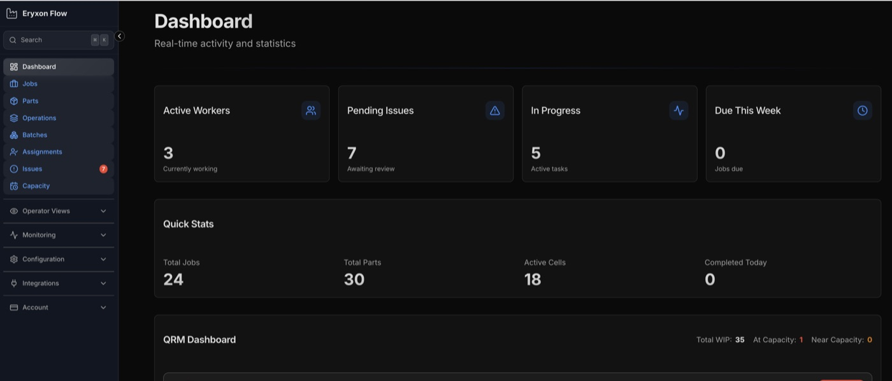
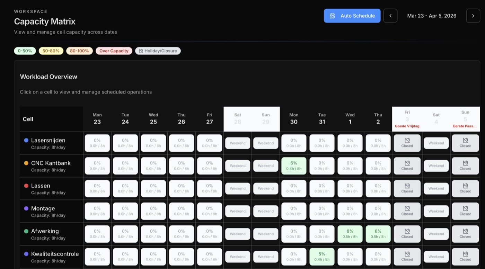
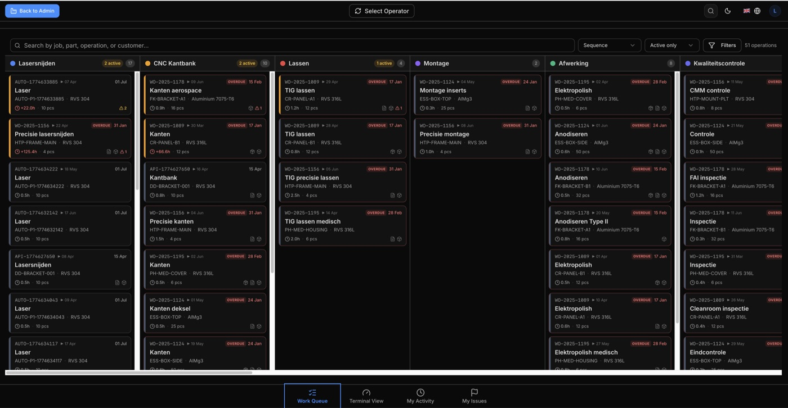
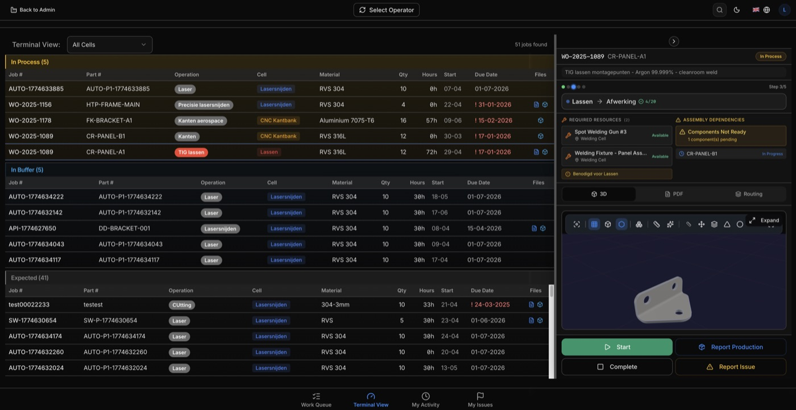
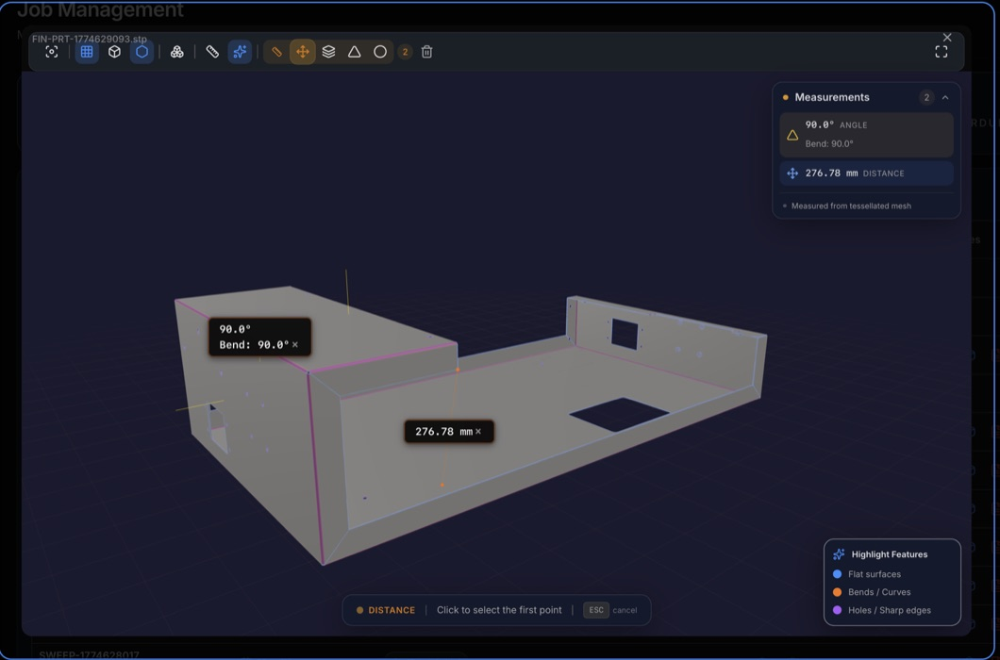
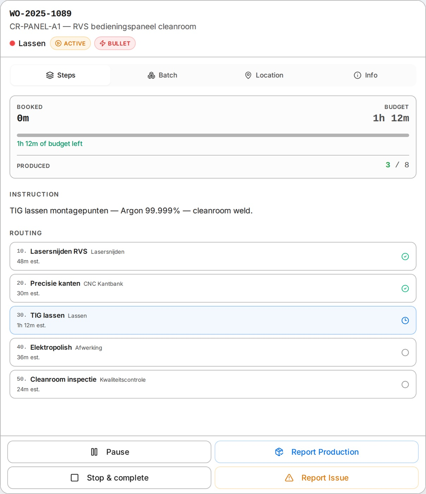
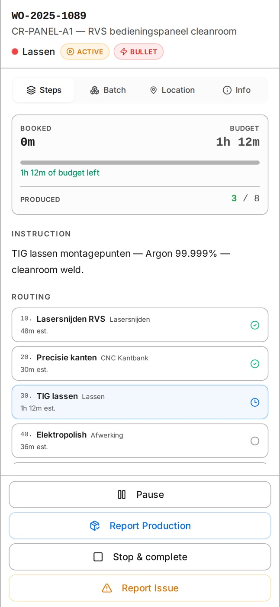
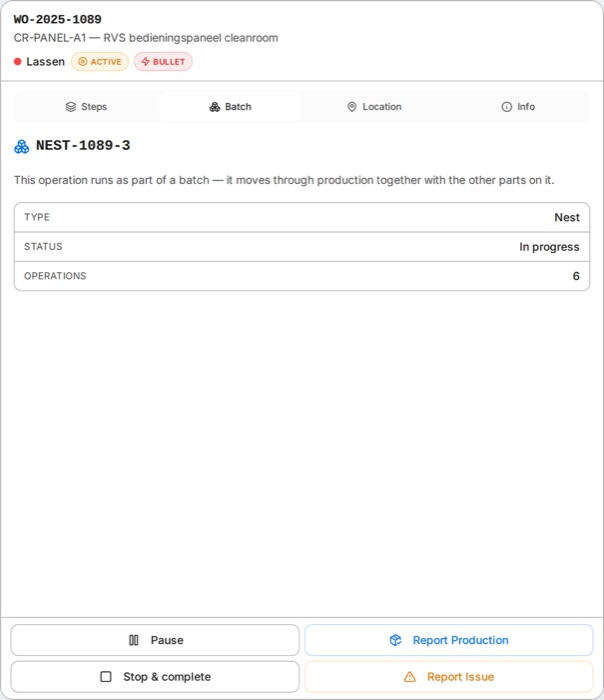
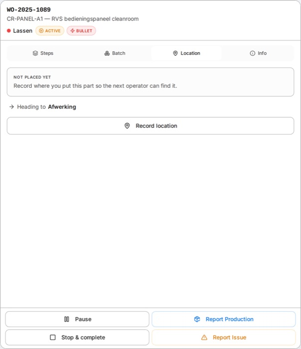
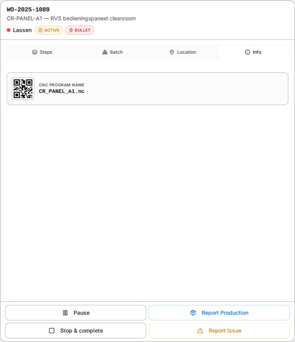

> **Eryxon Flow is archived.** This repository is a public archive and is no longer maintained. There is no hosted version. For custom adaptations, contact [Sheet Metal Connect](https://sheetmetalconnect.com/).

<p align="center">
  
</p>

<p align="center">
  <strong>Planning and shop floor execution for metalworking job shops</strong>
</p>

<p align="center">
  
  
  
  
</p>

---

Eryxon Flow is a manufacturing execution system for metalworking job shops: sheet metal, machine shops, custom fabrication. It is built for **high-mix, low-volume** production, where thousands of unique parts move through cutting, bending, welding and assembly and nobody has time to chase paper.

**For planners and managers** it gives one live view of every job, part and operation in production, with QRM capacity signals, issue tracking and a browser-based 3D viewer for STEP files.

**For operators** it gives a touch-friendly work queue on any tablet, kiosk or phone: clock in with a PIN, see what is next, record what happened.

**For the systems around it** it offers a REST API, webhooks and an MCP server, so your ERP or planning tool stays the system of record.

Self-host it with Docker; there is no hosted version.

## A look back

How Eryxon Flow looked and worked, kept for old times' sake. All screens show demo data.

**Dashboard.** Live activity, open issues and QRM work-in-progress per cell.



**Capacity matrix.** Load per cell per day, with weekends and holidays, and auto-scheduling.



**Work queue.** Every operation per cell as cards, with overdue flags, material and quantities.



**Operator terminal.** In process, in buffer and expected work, with the routing, resources and 3D model of the selected part.



**3D STEP viewer.** Runs in the browser: measure bends and distances, highlight flat surfaces, bends and holes.



**Operation detail.** What the operator sees per operation: time booked against budget, produced quantity, instructions and the routing with previous and next steps. Pause, report production, complete or report an issue from the same screen, on desktop and phone.

<p>
  
  
</p>

**Batch, location and info.** The nest a part runs in, where the part was put down and which cell it goes to next, and the CNC program with a QR code.

<p>
  
  
  
</p>

## Quick Start

Requires Node.js 22 and Docker (for the local Supabase stack).

```bash
git clone https://github.com/SheetMetalConnect/eryxon-flow.git
cd eryxon-flow
npm ci
npx supabase start      # local Postgres, auth, storage, Edge Functions; prints the API URL and anon key
cp .env.example .env    # paste that URL and anon key into VITE_SUPABASE_URL / VITE_SUPABASE_PUBLISHABLE_KEY
npm run dev             # http://localhost:8080 — the first sign-up creates the workshop
```

`npx supabase stop` shuts the stack down. To develop against a hosted Supabase project instead, put its URL and anon key in `.env` and skip `supabase start`.

| Layer | Tech |
|-------|------|
| Frontend | React 18, TypeScript, Vite, Tailwind CSS, shadcn/ui |
| Backend | Supabase (PostgreSQL 17, Edge Functions, Realtime) |
| 3D Viewer | Three.js with browser-side STEP parsing |
| Deployment | Docker (self-hosted) |
| API | REST with API key auth, rate limiting, webhook dispatch |

The app is a responsive web app for phones, tablets and desktops. Installable PWA support is off by default; build with `VITE_ENABLE_PWA=true` to enable it.

## Self-hosting

See [docs/SELF_HOSTING.md](docs/SELF_HOSTING.md).

## License

MIT. See [LICENSE](LICENSE).
